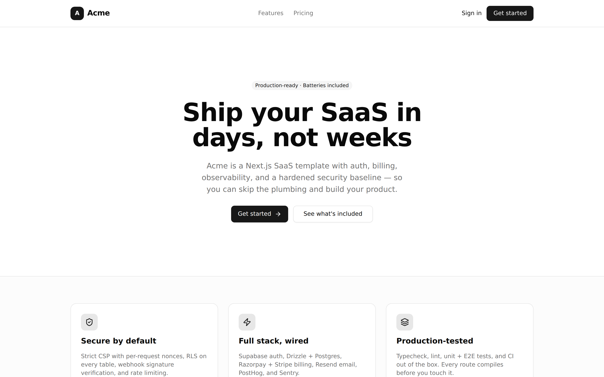

<h1 align="center">Next.js SaaS Template</h1>

<p align="center">
  Production-grade Next.js SaaS starter — auth, billing, email, security, and observability, wired and verified. Clone, configure, ship.
</p>

<p align="center">
  <a href="#features"><strong>Features</strong></a> ·
  <a href="#quick-start"><strong>Quick start</strong></a> ·
  <a href="#one-click-deploy"><strong>Deploy</strong></a> ·
  <a href="#documentation"><strong>Docs</strong></a> ·
  <a href="#project-structure"><strong>Structure</strong></a> ·
  <a href="#security-model"><strong>Security</strong></a> ·
  <a href="#make-it-yours"><strong>Make it yours</strong></a> ·
  <a href="#faq"><strong>FAQ</strong></a>
</p>

<div align="center">

[![CI][ci-image]][ci-url]
[![License: MIT][license-image]][license-url]
[![Next.js][next-image]][next-url]
[![TypeScript][ts-image]][ts-url]
[![Bun][bun-image]][bun-url]
[![PRs Welcome][prs-image]][prs-url]

</div>

<picture>
  <source media="(prefers-color-scheme: dark)" srcset=".github/assets/home-dark.png">
  
</picture>

**A batteries-included Next.js 16 boilerplate for SaaS products**: Supabase SSR authentication, Postgres with row-level security via Drizzle ORM, Stripe + Razorpay subscription webhooks, Resend transactional email, in-app notifications, file uploads, audit logging, PostHog analytics, Sentry error tracking, strict nonce-based CSP, rate limiting, Vitest + Playwright tests, and full SEO plumbing — all pre-wired so you start at your product, not the plumbing.

> [!TIP]
> **[Use this template](https://github.com/KRSHH/nextjs-template/generate)** to start a fresh repo, or clone directly. Every optional integration degrades gracefully — you can run the app with nothing but a Supabase project.

## Tech stack

- [Next.js 16](https://nextjs.org) (App Router, Turbopack) — framework
- [TypeScript](https://www.typescriptlang.org) (strict) — language
- [Tailwind CSS v4](https://tailwindcss.com) + [shadcn/ui](https://ui.shadcn.com) — styling & components
- [Supabase](https://supabase.com) — auth, Postgres, storage
- [Drizzle ORM](https://orm.drizzle.team) — type-safe SQL + RLS-declarative schema
- [Stripe](https://stripe.com) + [Razorpay](https://razorpay.com) — payments
- [Resend](https://resend.com) + [react-email](https://react.email) — email
- [PostHog](https://posthog.com) — product analytics
- [Sentry](https://sentry.io) — error tracking
- [Upstash Redis](https://upstash.com) — distributed rate limiting
- [Vitest](https://vitest.dev) + [Playwright](https://playwright.dev) — testing
- [Bun](https://bun.sh) — runtime, package manager, script runner

## Quick start

```bash
git clone https://github.com/KRSHH/nextjs-template.git my-saas
cd my-saas
bun install
bun run setup     # creates .env.local + shows exactly what's configured / missing
```

Fill in the two **required** services in `.env.local` (both from your free [Supabase project](https://supabase.com/dashboard) → Project Settings):

| Var                                                          | Where to find it            |
| ------------------------------------------------------------ | --------------------------- |
| `NEXT_PUBLIC_SUPABASE_URL` + `NEXT_PUBLIC_SUPABASE_ANON_KEY` | Project Settings → API      |
| `DATABASE_URL`                                               | Project Settings → Database |

Then:

```bash
bun run db:migrate   # schema + RLS policies + triggers + storage bucket
bun run db:seed      # optional dev data
bun run dev          # → http://localhost:3000
```

> [!NOTE]
> **How little env do you actually need?**
>
> - _Browse the marketing site_: the two Supabase vars — placeholder values suffice.
> - _Production build_: + `DATABASE_URL` set to any syntactically valid URL.
> - _Sign in / dashboard_: a real Supabase project with migrations applied.
>
> Everything else (Stripe, Razorpay, Resend, PostHog, Sentry, Turnstile, Upstash) is optional and switches on when its env vars are set. Re-run `bun run setup` any time to see the status of all of them.

> [!IMPORTANT]
> **Production rate limiting**: set `UPSTASH_REDIS_REST_URL` + `UPSTASH_REDIS_REST_TOKEN`. The in-memory limiter is dev-only; production intentionally **fails closed** without distributed storage. Same policy for `NOTIFICATIONS_UNSUBSCRIBE_SECRET`.

## One-click deploy

[](https://vercel.com/new/clone?repository-url=https%3A%2F%2Fgithub.com%2FKRSHH%2Fnextjs-template&project-name=my-saas&repository-name=my-saas&env=NEXT_PUBLIC_SUPABASE_URL,NEXT_PUBLIC_SUPABASE_ANON_KEY,SUPABASE_SERVICE_ROLE_KEY,DATABASE_URL&envDescription=Get%20these%20from%20your%20free%20Supabase%20project%20%E2%86%92%20Project%20Settings&envLink=https%3A%2F%2Fsupabase.com%2Fdashboard)

Deploys anywhere Next.js runs (Vercel, Railway, Fly.io, self-hosted Node/Bun). After deploying, hit `/api/health` — it reports DB connectivity and which optional integrations the deploy has configured.

> [!TIP]
> **On Vercel?** After deploying, install the [Supabase Vercel integration](https://vercel.com/integrations/supabase) and pick your project. It injects env vars under its own names (`POSTGRES_URL`, `SUPABASE_URL`, `SUPABASE_ANON_KEY`, …) — the app **auto-detects all of them**, so you don't have to create or alias anything by hand. Redeploy and you're live. See [Environment Variables](./docs/02-environment-variables.md) for the full alias list.

You can also open the repo in a ready-to-code [GitHub Codespace](https://codespaces.new/KRSHH/nextjs-template) — the devcontainer installs Bun, dependencies, and runs `bun run setup` for you.

## Documentation

In-depth guides live in [`docs/`](./docs/README.md). Start there for setup,
configuration, and deployment:

- [**Getting Started**](./docs/01-getting-started.md) — clone to running dev server.
- [**Environment Variables**](./docs/02-environment-variables.md) — every var, what it does, how to configure it across local/preview/staging/production.
- [Database](./docs/03-database.md) · [Auth](./docs/04-authentication.md) · [Billing](./docs/05-billing.md) · [Email & Notifications](./docs/06-email-notifications.md) · [Analytics & Errors](./docs/07-analytics-errors.md) · [Security](./docs/08-security.md) · [Testing](./docs/09-testing.md) · [Deployment](./docs/10-deployment.md) · [Architecture](./docs/11-architecture.md)

## Scripts

| Command                            | What it does                                |
| ---------------------------------- | ------------------------------------------- |
| `bun run setup`                    | Create `.env.local` + config doctor         |
| `bun run dev`                      | Next dev (Turbopack) on :3000               |
| `bun run build`                    | Production build                            |
| `bun run start`                    | Serve the production build                  |
| `bun run check`                    | Typecheck + lint + format check (CI parity) |
| `bun run typecheck`                | `tsc --noEmit`                              |
| `bun run lint` / `lint:fix`        | ESLint (flat config)                        |
| `bun run format` / `format:check`  | Prettier write / verify                     |
| `bun run test` / `test:watch`      | Vitest unit tests                           |
| `bun run test:e2e` / `test:e2e:ui` | Playwright E2E (auto-starts dev server)     |
| `bun run db:generate`              | Generate Drizzle migration from schema      |
| `bun run db:custom`                | Empty custom migration (triggers / raw SQL) |
| `bun run db:migrate`               | Apply pending migrations                    |
| `bun run db:push`                  | Push schema directly (dev only)             |
| `bun run db:studio`                | Drizzle Studio — browse your DB             |
| `bun run db:seed`                  | Seed dev data (2 profiles + subs + org)     |
| `bun run email:dev`                | react-email preview server on :3001         |

## Project structure

```
src/
├── app/                      # App Router
│   ├── (marketing)/          # Public site (home, pricing, features)
│   ├── (legal)/              # Privacy, Terms, Cookies, Contact (placeholder copy)
│   ├── (auth)/               # Sign-in / sign-up / forgot / reset / check-email
│   ├── app/                  # Protected dashboard (auth-gated) + settings + billing
│   ├── auth/                 # OAuth callback + sign-out route handlers
│   ├── api/                  # health, uploads, notifications, webhooks/{razorpay,stripe,resend}
│   ├── layout.tsx            # Root (fonts, metadata, providers, nonce)
│   ├── globals.css           # Tailwind v4 + design tokens
│   ├── {error,global-error,loading,not-found}.tsx
│   ├── {sitemap,robots,manifest}.ts
│   └── opengraph-image.tsx   # Dynamic OG image (edge)
├── components/
│   ├── ui/                   # shadcn/ui primitives (owned, MIT-style)
│   ├── marketing/            # Site nav + footer
│   ├── dashboard/            # Sidebar, user menu, theme toggle, notification bell
│   ├── auth/                 # Auth forms (react-hook-form + zod) + Turnstile
│   ├── settings/             # Profile / Account / Security / Linked-accounts
│   ├── seo/                  # JSON-LD
│   └── providers/            # PostHog
├── db/                       # Drizzle schema (RLS-declarative), client, seed
├── emails/                   # react-email templates (welcome, notification)
├── lib/
│   ├── supabase/             # SSR adapters: client, server, admin
│   ├── payments/             # Stripe, Razorpay, plans, subscriptions, idempotency
│   ├── notifications/        # Store, dispatcher, unsubscribe tokens
│   ├── uploads/              # Signed URLs, paths, quota enforcement
│   ├── audit/                # logAudit + actions registry + sanitizer
│   ├── auth/                 # Server actions + OAuth provider registry
│   ├── email/                # Resend client + send helpers
│   ├── analytics/            # PostHog server
│   ├── security/             # CSP builder, rate limiting
│   ├── site.ts               # Branding + SEO — single source of truth
│   └── seo.ts                # buildMetadata helper
├── instrumentation.ts        # Sentry server/edge init
├── instrumentation-client.ts # Sentry client init (replays)
└── proxy.ts                  # Middleware: CSP nonce, session refresh, auth gate, headers
```

## Security model

Defense-in-depth, on by default:

- **Strict CSP with per-request nonces** (`src/proxy.ts` + `src/lib/security/csp.ts`) — no `unsafe-inline` scripts in production, provider origins allowlisted only when configured.
- **Row-level security on every table**, declared in the Drizzle schema and applied by migration — plus revoked default privileges, so new tables start locked.
- **Server-authoritative subscription state** — only webhook handlers (signature-verified, idempotent) write `app.subscriptions`.
- **Fail-closed production posture** — rate limiting and unsubscribe-token signing refuse to run with missing secrets in production rather than degrade silently.
- **Signed, namespaced uploads** into a private bucket with MIME/size/quota checks server-side.
- **Full header bundle** — HSTS, `X-Frame-Options: DENY`, `nosniff`, referrer policy, permissions policy.

Found a vulnerability? See [SECURITY.md](SECURITY.md) — please report privately.

## Make it yours

1. **Brand** — edit `src/lib/site.ts` (name, title, description, keywords) or just set `NEXT_PUBLIC_APP_NAME`. The brand initial drives the logo monogram everywhere.
2. **Plans & pricing** — edit `src/lib/payments/plans.ts` (Starter/Pro → your tiers, USD/INR, trial length).
3. **Schema** — edit `src/db/schema.ts`, then `bun run db:generate`. For triggers, storage buckets, or SQL Drizzle can't express: `bun run db:custom` and fill in the generated file — it's tracked like any other migration.
4. **Email** — edit templates in `src/emails/`, preview with `bun run email:dev`, senders in `src/lib/email/send.ts`.
5. **Checkout** — the billing page ships with a stubbed upgrade button; wire it to Stripe Checkout / Razorpay subscriptions using the plan IDs already in env, and the webhooks take over from there.

## FAQ

<details>
<summary><strong>Do I need all these services to develop?</strong></summary>

No. Supabase (free tier) is the only requirement. Every other integration is opt-in via env vars and degrades gracefully when unset — the setup doctor (`bun run setup`) shows you exactly what's on. CI runs the whole test suite with zero external services.

</details>

<details>
<summary><strong>Why Bun? Can I use npm/pnpm?</strong></summary>

Bun is the default for speed (install + script running + TS execution without a build step). npm and pnpm work too — swap `bun run` for your runner and delete `bun.lock`. CI and the devcontainer assume Bun.

</details>

<details>
<summary><strong>Why both Stripe and Razorpay?</strong></summary>

Global cards (Stripe) + India/UPI (Razorpay). Both webhook handlers normalize into the same `app.subscriptions` table, so downstream code doesn't care which provider billed. Use one, both, or neither.

</details>

<details>
<summary><strong>Why Supabase for auth instead of NextAuth/Clerk/Lucia?</strong></summary>

One vendor covers auth + Postgres + storage with row-level security spanning all three, on a generous free tier — fewer moving parts for a template meant to ship. The Supabase surface is isolated in `src/lib/supabase/` if you want to swap it.

</details>

<details>
<summary><strong>How do I test webhooks locally?</strong></summary>

`stripe listen --forward-to localhost:3000/api/webhooks/stripe` (Stripe CLI), or point a Razorpay/Resend test webhook at a tunnel (e.g. `cloudflared tunnel`). Handlers verify signatures and enforce idempotency, so replays are safe.

</details>

## Contributing

PRs welcome! See [CONTRIBUTING.md](CONTRIBUTING.md) for setup and guidelines — the short version: keep it lean, keep it plug-and-play, and run `bun run check && bun run test` before pushing.

- [Report a bug](https://github.com/KRSHH/nextjs-template/issues/new?template=bug_report.yml)
- [Request a feature](https://github.com/KRSHH/nextjs-template/issues/new?template=feature_request.yml)
- [Discussions](https://github.com/KRSHH/nextjs-template/discussions)

If this template saves you time, a star helps others find it.

<details>
  <summary><kbd>Star History</kbd></summary>
  <picture>
    <source media="(prefers-color-scheme: dark)" srcset="https://api.star-history.com/svg?repos=KRSHH%2Fnextjs-template&theme=dark&type=Date">
    
  </picture>
</details>

## License

[MIT](LICENSE) — use it for anything, including commercial products.

<!-- Badge references -->

[ci-image]: https://github.com/KRSHH/nextjs-template/actions/workflows/ci.yml/badge.svg?branch=main
[ci-url]: https://github.com/KRSHH/nextjs-template/actions/workflows/ci.yml
[license-image]: https://img.shields.io/github/license/KRSHH/nextjs-template
[license-url]: LICENSE
[next-image]: https://img.shields.io/github/package-json/dependency-version/KRSHH/nextjs-template/next?label=Next.js&logo=nextdotjs&logoColor=white
[next-url]: https://nextjs.org
[ts-image]: https://img.shields.io/github/package-json/dependency-version/KRSHH/nextjs-template/dev/typescript?label=TypeScript&logo=typescript&logoColor=white
[ts-url]: https://www.typescriptlang.org
[bun-image]: https://img.shields.io/badge/Bun-1.3-14151a?logo=bun&logoColor=fbf0df
[bun-url]: https://bun.sh
[prs-image]: https://img.shields.io/badge/PRs-welcome-brightgreen.svg
[prs-url]: CONTRIBUTING.md
